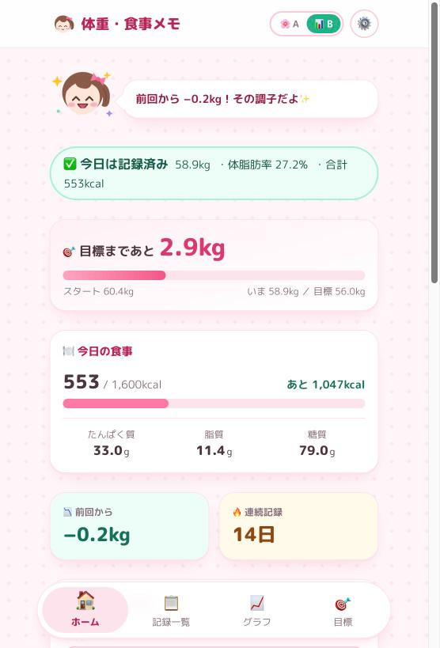
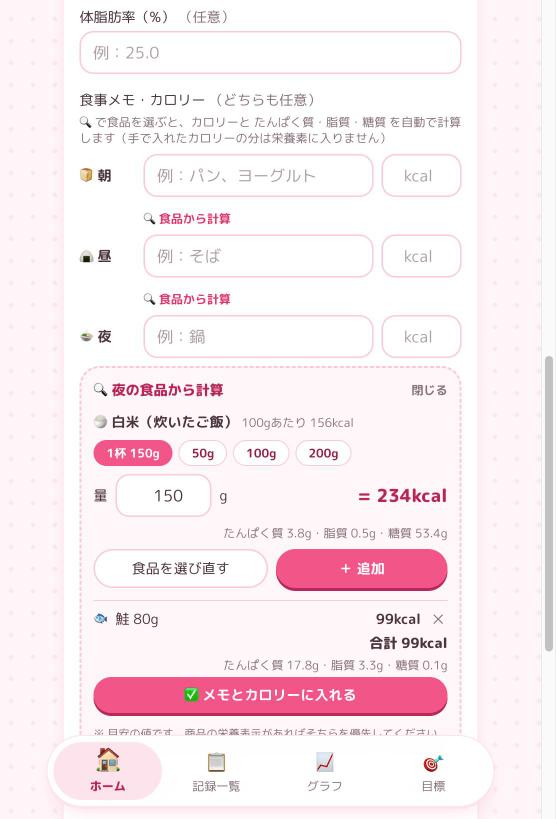
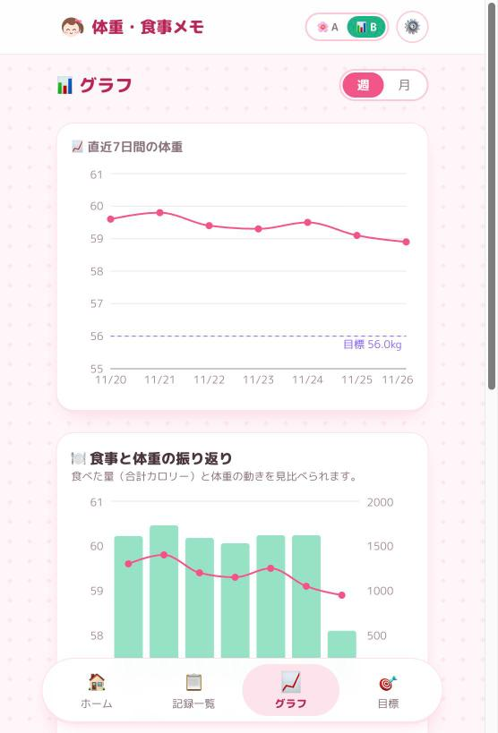
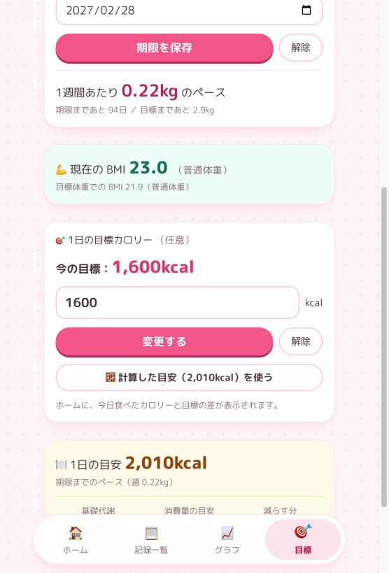
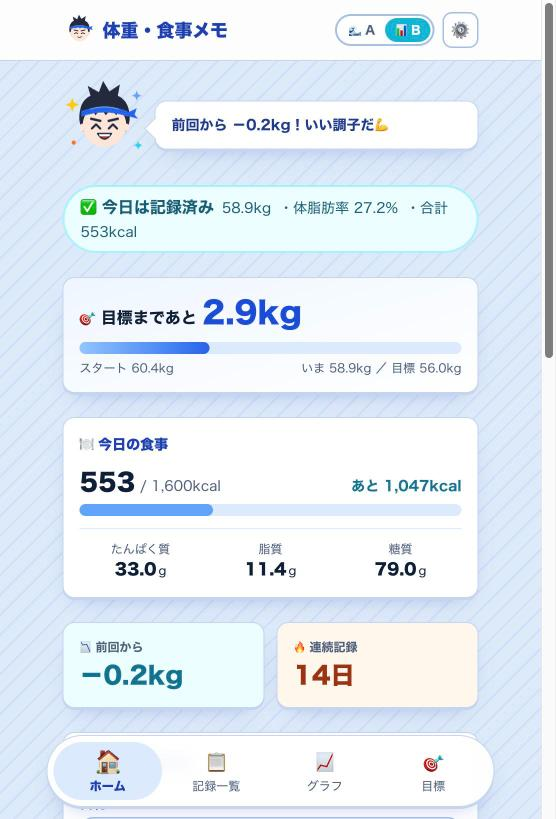
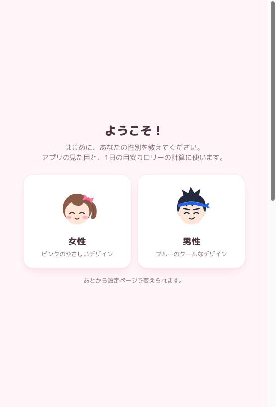

# 体重・食事メモ

毎日の体重と食事を記録して、目標体重までの進み具合を確かめられる Web アプリです。
パステルカラーとキャラクターで、楽しく続けられるようにしました。

**デモ：https://weight-memo-nine.vercel.app**

記録はブラウザの中（localStorage・IndexedDB）にだけ保存され、サーバーには送られません。
デモを触っても、ほかの人に記録が見えることはありません。

## スクリーンショット

| ホーム | 食品からカロリー計算 | グラフ |
| :---: | :---: | :---: |
|  |  |  |

| 1日の目標カロリー | 男性テーマ | 最初の性別選択 |
| :---: | :---: | :---: |
|  |  |  |

## 主な機能

- **体重・食事の記録**：1日1件。朝・昼・夜・間食ごとのメモとカロリー、体脂肪率、食事の写真
- **食品からカロリー自動計算**：食品を検索してグラム（「1杯 150g」などの目安ボタンあり）を入れると、`100gあたりkcal × g ÷ 100` で計算。約100品
- **たんぱく質・脂質・糖質**：食品から計算した分を食事ごとに保存し、1日の合計を表示
- **目標**：目標体重と期限、1週間あたりのペース、BMI、基礎代謝と活動量から出す1日の目安カロリー、自分で決める1日の目標カロリー
- **振り返り**：前回からの増減、連続記録日数、体重グラフ（週・月）、食事と体重を並べたグラフ、達成記録と次の目標の提案、CSV 書き出し
- **2つのモード**：A ゆるっと（体重とひとことメモだけ）／B しっかり（すべての機能）をヘッダーで切り替え。A で隠した項目のデータは消えない
- **見た目の切り替え**：最初に女性・男性を選ぶと、ピンク×ミントの女の子テーマ／ブルーの男の子テーマになる。応援メッセージやお祝いの言葉もテーマに合わせて変わる
- ダークモード対応、スマホ向けのレイアウト

## 技術スタック

| 分類 | 使っているもの |
| --- | --- |
| フレームワーク | [Next.js](https://nextjs.org) 16（App Router・Turbopack・Cache Components） |
| UI | [React](https://react.dev) 19、TypeScript 5 |
| スタイル | [Tailwind CSS](https://tailwindcss.com) v4（`@theme` の独自カラー、CSS 変数でテーマ・ダークモード切り替え） |
| グラフ | [Recharts](https://recharts.org) 3 |
| フォント | M PLUS Rounded 1c（`next/font/google`） |
| データ保存 | localStorage（記録・設定、`useSyncExternalStore` で読み書き）、IndexedDB（写真。長辺 800px の JPEG に縮小） |
| 品質チェック | ESLint 9（eslint-config-next）、`tsc --noEmit` |
| ホスティング | [Vercel](https://vercel.com) |

カロリー・栄養素の値は一般的な食品成分表をもとにした目安です。基礎代謝は Mifflin-St Jeor 式、活動量の係数は「日本人の食事摂取基準」の身体活動レベルを使っています。

## ローカルで動かす

Node.js 20 以上が必要です。

```bash
cd weight-memo
npm install
npm run dev      # http://localhost:3000
```

```bash
npm run lint     # ESLint
npx tsc --noEmit # 型チェック
npm run build    # 本番ビルド
```

## フォルダ構成

```
.
├── weight-memo/                 アプリ本体（Next.js）
│   ├── app/                     ページ（ホーム・記録一覧・グラフ・目標・設定）
│   ├── components/              画面の部品
│   └── lib/                     データ保存・計算（食品データは lib/foods.ts）
├── docs/screenshots/            README のスクリーンショット
├── 体重食事メモ-要件定義書.md     要件定義書（機能一覧 F-01〜F-31）
├── 体重食事メモ-story-map.html   ユーザーストーリーマップ
└── 体重食事メモ-sitemap.html     サイトマップ
```
